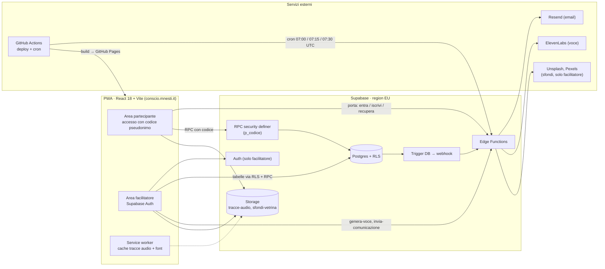
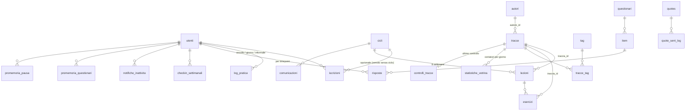

# Conscio · architettura dell'app

Fotografia della struttura al 2/10/2026 (commit `b110be0`, ramo `main`), aggiornata il 12/10/2026 per la vetrina Ascolta e il 13/10/2026 per la navigazione del facilitatore sotto `/admin`.
Complementare a `docs/progetto.md` (decisioni e registro) e `docs/design-system.md` (stile).

## 1. Vista d'insieme

## 2. Frontend

- **Stack:** React 18, React Router 6 (`HashRouter`, per GitHub Pages), Vite 5, `vite-plugin-pwa` (Workbox), Recharts, `react-speech-recognition` (note vocali), `lamejs` (MP3 in browser), font Source Serif 4 + Public Sans.
- **Provider** (`main.jsx`): `AuthProvider` (facilitatore) → `PartecipanteProvider` (codice, stato percorso, minuti ascolto) → `TonalitaProvider`.
- **Codice partecipante** salvato in `localStorage`; nessuna sessione Auth per i partecipanti.
- **Offline:** tracce da Storage in cache `CacheFirst` (con range requests, priming CORS in `lib/cacheTracce.js`); `sw-navigazione.js` gestisce la navigazione su iOS.

### Route

| Route | Guardia | Pagina |
|---|---|---|
| `/` | — | Splash |
| `/iscrizione`, `/entra`, `/segnala`, `/dati`, `/documenti/:slug`, `/ascolta`, `/ascolta/:slug` | pubbliche | Iscrizione, Entra, Segnala, IMieiDati, Documento (informative), Ascolta |
| `/onboarding`, `/questionari` | `SoloRegistrato` | Onboarding, Questionari (T0–T3) |
| `/programma`, `/pratica`, `/checkin`, `/comunicazioni` | `SoloPercorso` | Programma (tracce, informali, note), LogPratica (storico), Checkin, Avvisi (`Comunicazioni.jsx`, solo partecipante) |
| `/accedi` | — | login facilitatore → `/admin/cicli` |
| `/admin/cicli` | `SoloFacilitatore` | `pages/admin/Cicli.jsx`: da fare, KPI, cicli, percorsi da remoto |
| `/admin/cicli/:cicloId/{panoramica,iscritti,programma,pratica,questionari}` | idem | `pages/admin/Ciclo.jsx` (testata + schede) e `pages/admin/ciclo/*`; i dati del ciclo vengono da `useCiclo(cicloId)` |
| `/admin/cicli/:cicloId/programma/settimana/:numero` | idem | `pages/admin/ciclo/EditorSettimana.jsx` |
| `/admin/tracce` (`?traccia=`, `?ciclo=`, `?filtro=da-guardare\|vetrina\|non-controllate`) | idem | `pages/admin/Tracce.jsx` + `SchedaTraccia.jsx` nel `PannelloLaterale`; controlli con `useControlliTracce` |
| `/admin/tracce/nuova?modo=carica\|genera[&sostituisci=<id>]` | idem | `pages/admin/NuovaTraccia.jsx`, `GeneraDaScript.jsx` (ElevenLabs) |
| `/admin/comunicazioni`, `/admin/sito` | idem | `pages/admin/Comunicazioni.jsx`, `pages/admin/Sito.jsx` |

Redirect delle vecchie rotte: `/dashboard`, `/lezioni` → `/admin/cicli`; `/percorso?ciclo=X` → `/admin/cicli/X/programma`; `/percorso/:id/settimana/:n` → `…/programma/settimana/:n`; `/libreria` → `/admin/tracce`; `/genera` → `/admin/tracce/nuova?modo=genera`; `/controllo-tracce?ciclo=X` → `/admin/tracce?ciclo=X&filtro=da-guardare`; `/comunicazioni` → `/admin/comunicazioni` solo per il facilitatore.

Due "chrome": partecipante (`Nav` + `BarraBassa` + `Footer`) e facilitatore (`AdminChrome`, solo sotto `/admin`; su telefono `BarraVoci`, la stessa barra del partecipante con le quattro voci del facilitatore). Un solo design system (`tokens.css`). La barra bassa non include Ascolta. L’indirizzo senza cancelletto `/ascolta` arriva da `public/ascolta/index.html` (e da `public/404.html` per lo slug): entrambi portano a `/#/ascolta`, senza codice.

### Moduli `src/lib` principali
`supabaseClient` (client + `chiamaPorta`) · `auth` · `partecipante` · `ascolto` (credito ascolto al 90–95%) · `vetrina` (pagine pubbliche e scheda del facilitatore; in modalità vetrina il player non accredita la pratica) · `tracce` / `cacheTracce` / `riproduzioneAudio` · `controlloTracce` + `useControlliTracce` (collegamenti, file, ascolto tecnico; esiti salvati) · `cicli` + `useCiclo` (cicli, iscrizioni, KPI, azioni sulle iscrizioni, badge «da fare») · `checkin` · `scoring` (PSS-10, FFMQ-I) · `pratica` / `storico` (aderenza, giornate) · `generaVoce` + `audioMp3` · `tono` / `tonalita` / `colori`.

## 3. Modello dati (Postgres)

| Gruppo | Tabelle |
|---|---|
| Identità e consensi | `utenti` (codice, email operativa, ruolo, `consenso_modulo_a`, `consenso_modulo_b`, `consenso_checkin_il`) |
| Organizzazione | `cicli`, `iscrizioni` (screening, modalità `presenza`/`remoto`) |
| Contenuti | `tracce` (con `file_aggiornato_il`, data dell’ultimo file caricato), `lezioni`, `esercizi`, `autori`, `tag`, `tracce_tag`, `controlli_tracce` (ultimo controllo di file e ascolto tecnico per traccia: stato, esiti, misure, `controllato_il`; solo facilitatore. «Da ricontrollare» quando `controllato_il < file_aggiornato_il`; i collegamenti dipendono dal ciclo e non si salvano) |
| Dati di pratica | `log_pratica`, `checkin_settimanali` |
| Misure | `questionari`, `item`, `risposte` (PSS-10, FFMQ-I · T0–T3) |
| Comunicazione | `comunicazioni`, `notifiche_inattivita`, `promemoria_questionari`, `promemoria_pausa`, `quotes`, `quote_sent_log` |
| Sistema | `limiti_richieste` (tetti per IP hashato), `splash_sito`, `impostazioni_sito` (vetrina spenta di default), `statistiche_vetrina` (conteggi aggregati per traccia e giorno, senza identificativi), `backfill_collegamenti_tracce`, `segnalazioni_problema` (testo collegato all’account, solo per l’avviso di chiusura; niente codice né email verso l’agente) |

**Accesso:** nessuna tabella dei partecipanti è leggibile dal client anonimo. Il partecipante passa solo da RPC `security definer` con `p_codice` (es. `programma_del_partecipante`, `registra_ascolto_formale`, `salva_risposte_questionario`, `salva_checkin`, `esporta_dati_del_partecipante`, `resetta_dati_del_partecipante`). Il facilitatore (`is_facilitatore()`) legge tabelle via RLS e usa RPC pseudonime (`risposte_pseudonime`, `log_pratica_pseudonimi`, `segnalazioni_difficili_aperte`).

La vetrina pubblica, spenta finché `impostazioni_sito.vetrina_attiva` non è vero, si legge solo dalle RPC `vetrina_elenco`, `vetrina_traccia`, `vetrina_in_evidenza` e `vetrina_impostazioni` (anon, solo tracce con `pubblica`). I conteggi passano da `porta` (`evento-vetrina`) a `registra_evento_vetrina`, eseguibile solo da `service_role`. Non scrivono in `log_pratica`. `programma_del_partecipante` continua a leggere solo le colonne che già nominava.

Lo schema vive in `supabase/schema.sql` + ~45 `migrazione_*.sql` (l'ultimo file che ridefinisce una funzione vince).

## 4. Edge Functions

| Funzione | Innesco | Fa | Servizi |
|---|---|---|---|
| `porta` | app (Entra, Iscrizione, recupero codice, Accedi, Segnala, conteggi Ascolta) e l’agente a fine correzione | rate limit per IP, iscrizione, stato codice, invio codice, avvio analisi segnalazione, chiusura con email a gestore e partecipante, `evento-vetrina` | Resend, webhook Cursor |
| `invia-comunicazione` | facilitatore | email ai destinatari del ciclo (o solo remoti) | Resend |
| `invia-incoraggiamento-pratica` | trigger su INSERT `log_pratica` (`tipo='giorno'`) | email con giorno 1–56 + citazione della settimana | Resend |
| `avvisa-segnalazione-checkin` | trigger su `checkin_settimanali` | avviso al facilitatore (solo codice e settimana), con link a `#/admin/cicli` | Resend |
| `notifica-inattivita` | cron GitHub 07:00 UTC / bottone facilitatore | avvisi e ritiro iscritti remoti inattivi (15+15 gg) | Resend |
| `promemoria-questionari` | cron GitHub 07:30 UTC | promemoria T3 (apertura e −7 gg) | Resend |
| `promemoria-pausa` | cron GitHub 07:15 UTC / bottone facilitatore | email a chi non ascolta una traccia da tre giorni di fila | Resend |
| `genera-voce` | facilitatore (`/admin/tracce/nuova?modo=genera`) | sintesi vocale delle tracce | ElevenLabs |
| `cerca-sfondi` | facilitatore | ricerca foto Unsplash e foto/video Pexels; alla scelta, download Unsplash e copia del file Pexels nel bucket | Unsplash, Pexels |

Condivisi in `functions/_shared/`: stile e firma email, testo di incoraggiamento, curiosità mindfulness.

## 5. Flussi chiave

1. **Iscrizione:** Iscrizione → `porta` (iscrivi) → `iscrivi_partecipante` → codice via email; Modulo A e B indipendenti.
2. **Ingresso:** codice → `porta` (stato) → `stato_pronto_percorso` → onboarding → T0 → percorso.
3. **Pratica:** ascolto traccia → oltre 90–95% `registra_ascolto_formale` (`log_pratica.tipo='ascolto'`) → «Registra la pratica di oggi» (`tipo='giorno'`, tono + nota) → trigger → email di incoraggiamento.
4. **Check-in settimanale:** consenso separato (`dai_consenso_checkin`) → `salva_checkin` (non modificabile) → se esperienza difficile, avviso al facilitatore.
5. **Questionari:** finestre T0/T1/T2/T3 calcolate lato DB (`timepoint_in_finestra`); punteggi calcolati in `lib/scoring.js`.
6. **Diritti GDPR:** `/dati` → export e reset tramite RPC; `ritira_partecipante` / `ritira_inattivo` lato facilitatore/cron.

## 6. Deploy e configurazione

- **Push su `main`** → `deploy.yml` → build Vite → GitHub Pages (dominio `conscio.mnesti.it`, `public/CNAME`). Chiavi anon in `.env.production` (pubbliche, protette da RLS).
- **Edge Functions** distribuite a mano con `supabase functions deploy`; secret: `RESEND_API_KEY`, `RESEND_FROM`/`EMAIL_FROM`, `CRON_SECRET`, `ENCOURAGEMENT_SECRET`, `CHECKIN_WEBHOOK_SECRET`, `FACILITATORE_EMAIL`, `ELEVENLABS_API_KEY`, `CURSOR_AUTOFIX_WEBHOOK_URL`, `CURSOR_AUTOFIX_WEBHOOK_KEY`, `UNSPLASH_ACCESS_KEY`, `PEXELS_API_KEY`.
- **Storage:** `tracce-audio` (pubblico, audio del percorso) e `sfondi-vetrina` (pubblico, foto fino a 10 MB e video fino a 50 MB; il tetto del bucket è 50 MB). Gli sfondi Unsplash restano sui loro server.
- **Migrazioni SQL** applicate manualmente (SQL editor / MCP) e sempre versionate in `supabase/`.
- **Strumenti:** Cursor e Claude Code sul repo; Claude su claude.ai per analisi, mockup e brief (`docs/brief_*.md`, `docs/mockup/`).

## 7. Aperto (da `docs/progetto.md`)

Non ancora implementati: pagine statiche di condivisione `/a/<slug>/` e import da YouTube, andamento del check-in (partecipante + scheda facilitatore, RPC `checkin_storico_del_partecipante` proposta), schermata «Il tuo andamento» nei questionari, consenso specifico per citazioni dei partecipanti. Le pagine `/ascolta` e la scheda nella scheda traccia e in `/admin/sito` ci sono; l’interruttore nasce spento.
