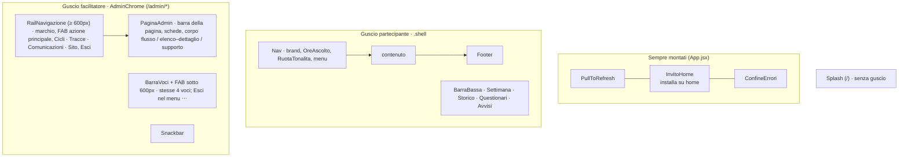

# Conscio · mappa dell'interfaccia

Inventario degli elementi grafici dell'app: gusci, schermate, componenti e pattern ricorrenti, con il
file in cui vivono. Fotografia al 13/10/2026 (navigazione del facilitatore riorganizzata).

**Da leggere prima di ogni re-design o integrazione**, insieme a:
- `docs/design-system.md` → *come* appare (token, tipografia, classi base `.btn`, `.card`, `.field`, `.dialogo`…);
- questo file → *cosa* esiste e *dove* (quale schermata usa quale blocco);
- `docs/architettura.md` → dati e funzioni dietro ogni schermata.

## 1. Gusci (chrome)

| Guscio | File | Note |
|---|---|---|
| Partecipante | `Nav.jsx`, `BarraBassa.jsx`, `Footer.jsx` | `Nav` mostra voci diverse se c'è un codice attivo; `BarraBassa` è la navigazione principale su telefono. Il facilitatore che apre una pagina pubblica o del partecipante vede questo guscio, con il solo link «Area facilitatore» |
| Facilitatore | `AdminChrome.jsx` (+ `styles/admin.css`) | Solo sotto `/admin`. Regola: il menu dice su quale oggetto lavori (Cicli, Tracce, Comunicazioni, Sito), le schede dicono quale aspetto. Badge su Cicli = segnalazioni difficili aperte + iscrizioni in attesa di esito. Niente testata globale: rail a sinistra da 600px (compatto, esteso da 1200px) con l'azione principale della sezione come FAB; sotto 600px `BarraVoci` in basso, FAB sopra e «Esci» nel menu ⋯ della pagina. Ogni pagina è un `PaginaAdmin` (barra della pagina + layout): regole in `docs/framework_layout_facilitatore.md` |
| Nessuno | `Splash.jsx` | Contenuto da `splash_sito`, modificabile dalla tab Sito |

## 2. Schermate e blocchi che le compongono

### Pubbliche e ingresso
| Schermata | Route | Blocchi |
|---|---|---|
| Splash | `/` | hero + CTA (`.splash-*`) |
| Iscrizione | `/iscrizione` | presentazione percorso e cicli, modulo con consensi A e B separati, `Disclaimer`, `BoxCodicePrivacy`, conferma con codice copiabile (`ConfermaIscrizione`) |
| Entra | `/entra` | campo codice, `BoxCodicePrivacy`, `Disclaimer`, «Recupera il codice» |
| Documento | `/documenti/:slug` | informative a sezioni numerate (`.doc`) |
| I tuoi dati | `/dati` | `IdentitaCodice`, card Export e Reset, `DialogConferma` |
| Segnala | `/segnala` | `SegnalaProblema` (con campo trappola anti-spam) |
| Accedi | `/accedi` | login facilitatore (card + 2 campi) |
| Ascolta | `/ascolta` | card della meditazione della settimana con play rotondo (`PlayerVetrina`), invito al percorso. Tre stati: caricamento, «La sezione non è ancora aperta», errore |
| Meditazione | `/ascolta/:slug` | card con play (`PlayerVetrina`), scheda (testo, licenza, fonte, voce), condivisione, «Ascolta un’altra» |

Le tavole di riferimento sono in `docs/mockup/ascolta-*.png`. La vetrina usa il guscio del partecipante anche se il facilitatore è entrato. Nell’header di Ascolta resta solo il logo, senza menu. Il link in nav delle altre pagine compare solo con la vetrina accesa. La barra bassa non ha la voce Ascolta.

### Partecipante (dopo il codice)
| Schermata | Route | Blocchi |
|---|---|---|
| Onboarding | `/onboarding` | Benvenuto, `AvvisoDatiPseudonimi`, atteggiamenti della mindfulness (card), `CampoNota` |
| Questionari | `/questionari` | flusso a passi `scelta → avviso → domanda → esito`; `ScalaLikert`, `Disclaimer`, esito con `IndicatoreOrientamento` (non clinico) |
| Settimana | `/programma` | intestazione settimana, `CalendarioPratica`, «Da fare ogni giorno» con `CardTracciaAudio` (formali), `GuidaMeditazione`, «Pratiche informali» (spunta), «Annotazioni del giorno» con `TonoEsperienza` + `CampoNota`, `VoceLog`, `CardCheckin`, invito all'incontro remoto |
| Storico | `/pratica` | `StoricoGiornate` (contatori + una riga per giornata: barra minuti colorata dal tono, `TonoIcon`, nota) |
| Check-in | `/checkin` | consenso separato → cursori (stress, sonno, presenza) → ostacoli → momenti difficili → grazie / già registrato |
| Avvisi | `/comunicazioni` | elenco comunicazioni del partecipante, `StatoVuoto` |

Fallback comune: senza codice in memoria le pagine mostrano `ChiediCodice`; durante il caricamento `StatoAttesa`.

### Facilitatore
Tutto sotto `/admin`; le vecchie rotte (`/dashboard`, `/percorso…`, `/lezioni`, `/libreria`, `/genera`, `/controllo-tracce`, `/comunicazioni` per il facilitatore) sono solo redirect.

| Schermata | Route | Blocchi |
|---|---|---|
| Cicli (home) | `/admin/cicli` (`?nuovo=1` apre il modulo «Nuovo ciclo», dal rail) | flusso. Barra: «Esporta dati aggregati». «Da fare» (segnalazioni difficili con «Segna come gestita» → snackbar; segnalazioni di problemi dell’app con stato In lavorazione / Risolta / Non risolta, esito dell’agente e link alla pull request, «Archivia» → snackbar con «Annulla»; iscrizioni in attesa per ciclo; «Niente da fare»), card KPI (`.dash-kpi-card`), tabella cicli, «Percorsi individuali da remoto» (`RigaIscrizione`, `#remoti-liberi`), link «Questionari · tutti i cicli» |
| Spazio del ciclo | `/admin/cicli/:id/…` | barra della pagina (`Ciclo.jsx`): «← Cicli», nome, stato, date, selettore che cambia ciclo tenendo la scheda (contesto); schede `.pagina-scheda` legate alla rotta (`role="tablist"`, `aria-current`) |
| · Panoramica | `…/panoramica` | numeri del ciclo, date e stato, posti in presenza, link incontro, «Zona delicata» (elimina con `DialogConferma`) |
| · Iscritti | `…/iscritti` | filtri a pillola (`.filtri-chip`): tutte, in attesa di esito, idonei, in presenza, da remoto; righe `RigaIscrizione` (esito, modalità, ritiro) |
| · Programma | `…/programma` | 9 card settimana (`.percorso-griglia`); avviso «N tracce da guardare» → `/admin/tracce?ciclo=…&filtro=da-guardare` |
| · Settimana | `…/programma/settimana/:n` | `EditorSettimana`: lezione + esercizi, `SelettoreTraccia`, dialoghi di modifica |
| · Pratica | `…/pratica` | `SchedaPratica` del ciclo: quattro numeri, barre per giorno colorate per tono, mappa del percorso, informali |
| · Questionari | `…/questionari` | grafici per strumento (Recharts), `BarraRange`, sottoscale, interruttore «Tutti i cicli» (`?tutti=1`); solo aggregati e codici |
| Tracce | `/admin/tracce` | elenco–dettaglio. Barra: `SplitButton` «Controlla tutte» (tutta la libreria · solo quelle in elenco · solo il ciclo filtrato) / «Interrompi»; «Nuova traccia» è nel rail. Nell'elenco: ricerca, selettore «Usate in…» (`?ciclo=`), chip Tutte · Da guardare · In vetrina · Non controllate (`?filtro=`). Riga: titolo, durata, date, spunta «In vetrina», stato del controllo (`.controllo-stato`: Funziona, Da guardare, Problema, Non controllata, Da ricontrollare), ascolta, apri scheda. Con un ciclo scelto: «Pratiche senza traccia in libreria» |
| Scheda traccia | `/admin/tracce?traccia=<id>` | `PannelloDettaglio` (a destra da 840px, pagina intera sotto) con `SchedaTraccia`: Ascolto, Contenuto, File (sostituisci · rigenera da script; se c’è uno script salvato lo dice, con il numero di paragrafi), Vetrina (`ModuloVetrina`), Dove è usata (link alle settimane), Controllo (esiti per livello, «Ascolta da», «Ricontrolla»), Elimina (`.btn-ghost.is-pericolo` → `DialogConferma`, blocco «Traccia ancora collegata») |
| Nuova traccia | `/admin/tracce/nuova?modo=carica\|genera` | scelta Carica un file / Genera da script (`GeneraDaScript`); con `&sostituisci=<id>` riapre lo script salvato e rigenera il file. «Salva lo script» non cambia l’audio in libreria. Al salvataggio del file torna alla scheda e il controllo parte da solo |
| Comunicazioni | `/admin/comunicazioni` (`?voce=<id>\|nuova\|inattivita\|pausa`, `?filtro=programmate\|inviate\|automatiche`; `?nuova=1` dal rail apre il modulo) | elenco–dettaglio. Elenco con chip Tutte · Da inviare · Inviate · Automatiche e tre gruppi; righe `.riga-elenco` con stato. Dettaglio: modulo (nuova o da inviare: salva, prova a me, «Invia ora», Cancella), comunicazione inviata in sola lettura con «Riusa il testo», email automatiche (inattività da remoto, pausa di pratica) con regola, persone in attesa, «Controlla e invia ora» e storico. Ogni invio passa da `DialogConferma`; gli esiti vanno nella snackbar |
| Sito | `/admin/sito` | supporto. Barra: «Apri Ascolta»; nessuna azione nel rail. `EditorSplash`, `EditorVetrina` (interruttore, testi dell’invito, calendario, conteggi) a sinistra; «Uso dei dati e dei punteggi» nel pannello di supporto (finché la frase di apertura non ha un'anteprima) |

## 3. Catalogo componenti (`src/components`)

| Famiglia | Componenti |
|---|---|
| Guardie (nessuna UI propria) | `SoloRegistrato`, `SoloPercorso` (blocca finché onboarding + T0 non sono completi), `SoloFacilitatore` |
| Stati di sistema | `StatoAttesa` (anello), `StatoVuoto` (titolo + testo), `ConfineErrori` (card errore + segnalazione) |
| Accesso e identità | `ChiediCodice`, `BoxCodicePrivacy`, `IdentitaCodice` |
| Avvisi, consenso, privacy | `Disclaimer` (`.avvertenza`, chiudibile), `AvvisoDatiPseudonimi`, `.disclaimer` (classe) |
| Modali e inviti | `DialogConferma` (`.dialogo`), `InvitoHome` (installazione PWA), `InvitoCheckin` (modale a ogni apertura finché manca il check-in) |
| Audio e pratica | `CardTracciaAudio` (player, eyebrow, stato «ascoltata», barre cliccabili per saltare a un punto; con `modalita="vetrina"` non segna l’ascolto e non prepara l’offline; con `vista` un altro componente disegna i controlli sulla stessa logica), `PlayerVetrina` (card, player a schermo intero con descrizione a tre righe e «Leggi tutto», scheda «Crediti e licenza» dal basso, barra ridotta quando è chiuso), `GuidaMeditazione` (carosello di posture: `assets/guida/*.png`), `LibreriaTracce`, `CalendarioPratica`, `VoceLog` |
| Tono della giornata | `TonoEsperienza` (scelta), `TonoIcon` (faccina SVG), `TonoMini` (etichetta) |
| Input | `CampoNota` (testo + dettatura), `ScalaLikert`, `SegnalaProblema` |
| Dati e grafici | `SchedaPratica`, `StoricoGiornate`, `IndicatoreOrientamento`, `OreAscolto` |
| Personalizzazione | `RuotaTonalita` (ruota l'accento e il fondo, vedi `lib/tonalita.js`) |
| Admin | `AdminChrome`; in `components/admin/`: `RailNavigazione`, `PaginaAdmin`, `ElencoPannello` + `PannelloDettaglio`, `AreaPrincipale` + `PannelloSupporto` (`Pannelli.jsx`), `SnackbarProvider` / `useSnackbar`, `SplitButton`, `MenuAzioni`, `IconeAdmin`, `useGuscio` (`gusci.js`); `AdminDialogo` (modale delle pagine facilitatore), `RigaIscrizione` (una iscrizione con esito, modalità, ritiro; «Collega a un ciclo» per i percorsi liberi), `EditorSplash`, `EditorVetrina`, `ModuloVetrina`, `ScegliSfondo` |
| Navigazione | `Nav`, `BarraBassa` (voci del partecipante), `BarraVoci` (la barra in basso vera e propria, con voci e badge passati come prop: la usano `BarraBassa` e `AdminChrome`), `Footer`, `PullToRefresh` |

**Non usati oggi:** `GraficoAndamentoPratica.jsx`, `TracciaGuidata.jsx`. Prima di riprenderli verifica che seguano il design system, altrimenti eliminali.

**Sottocomponenti locali** (definiti dentro la pagina, non riusabili così come sono): `Consenso`, `Cursore`, `GiaRegistrato` (Checkin); `TaskFormale`, `AnnotazioniGiorno`, `VuotoProgramma` (Programma); `EditorDialogo` (EditorSettimana); `GraficoStrumento`, `BarraRange`, `SchedaCodice` (admin/ciclo/Questionari); `CaricaFile` (NuovaTraccia); le icone `Icona*` (Tracce, Iscrizione; quelle del guscio sono in `components/admin/IconeAdmin.jsx`). Se un secondo file ne ha bisogno, spostali in `components/`.

## 4. Pattern ricorrenti

- **Flusso a passi**, una cosa alla volta: Questionari, Check-in, Iscrizione, Onboarding. Ogni passo è una card con titolo serif, testo e azioni in fondo (`.azioni`).
- **Card numerica / card con titolo / tabella**: definite in `design-system.md`, usate da Cicli, spazio del ciclo, SchedaPratica e Storico.
- **Fallback a tre stati** in ogni pagina dati: attesa (`StatoAttesa`) → vuoto (`StatoVuoto` o `.card-vuota`) → errore (`.avviso-errore`).
- **Conferme distruttive**: sempre `DialogConferma` con `.btn-pericolo`; il pulsante che la apre è `.btn-ghost.is-pericolo`.
- **Conferme reversibili** (area facilitatore): l'azione si esegue subito e `useSnackbar().mostra()` la conferma, con «Annulla» se una funzione di `lib/` ripristina lo stato.
- **Linguaggio**: «pratica», «percorso», «programma»; mai termini clinici. Gli esiti dei questionari si mostrano come posizione su una scala, senza interpretazione.
- **Privacy visibile**: dove compare il codice c'è sempre una spiegazione (`BoxCodicePrivacy`, `AvvisoDatiPseudonimi`); il facilitatore vede note e codici solo dove serve (segnalazioni), altrove solo aggregati.

## 5. Layout e responsive

- Mobile first. Breakpoint usati in `styles.css`: 720px (il più frequente), 860px, 960px; `max-width: 640px` solo per eccezioni. `prefers-reduced-motion` è rispettato. L'area facilitatore usa le classi di finestra M3 (600 / 840 / 1200, `useClasseFinestra`); l'area partecipante migrerà dopo.
- Partecipante: colonna singola in `.shell`; su telefono le voci principali passano in `BarraBassa` (fissa in basso) e `Nav` tiene solo le secondarie (classe `body.has-barra-bassa`).
- Facilitatore: `AdminChrome` sotto `/admin` con la classe di finestra su `.admin-app` (`is-compatta`, `is-media`, `is-espansa`, `is-ampia`). La larghezza la decide il layout di `PaginaAdmin` (al massimo 1360px), non la rotta.
- CSS: `styles/tokens.css` (valori), `styles.css` (componenti e pagine, ~5.200 righe, prefissi per pagina: `.dash-`, `.storico-`, `.checkin-`…), `styles/admin.css` (solo layout dell'area facilitatore).

## 6. Checklist per re-design e integrazioni

1. Trova la schermata nella sezione 2 e i componenti coinvolti nella sezione 3.
2. Riusa un componente o una variante esistente prima di crearne uno nuovo (`design-system.md`, «Componenti condivisi»).
3. Solo token: nessun colore, font o raggio scritto a mano. Se cambi un token, aggiorna anche `lib/colori.js` e `_shared/stileEmail.ts`.
4. Prevedi i tre stati (attesa, vuoto, errore) e il fallback `ChiediCodice` per le pagine del partecipante.
5. Controlla i due gusci se tocchi navigazione o larghezze.
6. Mockup in `docs/mockup/`, istruzioni in `docs/brief_*.md`; a lavoro fatto aggiorna questo file e il registro in `docs/progetto.md`.
